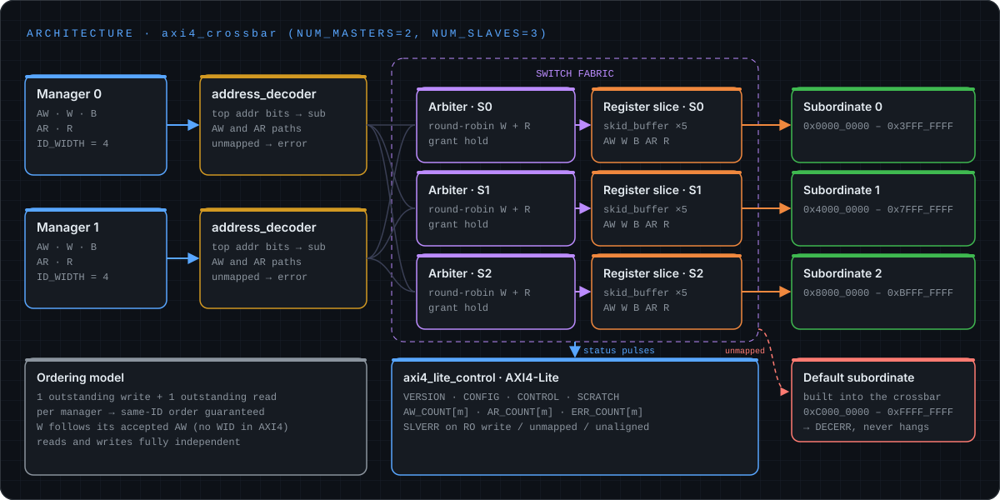
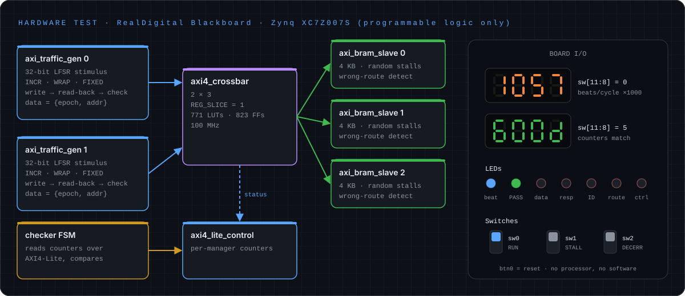

<div align="center">



<br/>


-2ea043?style=flat-square)

**A parameterised AXI4 N×M crossbar with an AXI4-Lite control plane. I wrote it from the AMBA specification,
verified it until it stopped arguing, and ran it on real silicon.**

[Architecture](#architecture) · [Verification](#verification) · [On hardware](#on-real-hardware) ·
[Results](#results) · [Bug wall](#the-bug-wall) · [Quick start](#quick-start)

</div>

---

## By the numbers

<div align="center">

<table>
<tr>
<td align="center" width="25%"><h2>1,521</h2>transactions checked<br/><sub>0 errors · slices on</sub></td>
<td align="center" width="25%"><h2>4 / 4</h2>injected bugs caught<br/><sub>mutation testing</sub></td>
<td align="center" width="25%"><h2>771</h2>LUTs for the crossbar<br/><sub>823 FFs · 5.4 % of the device</sub></td>
<td align="center" width="25%"><h2>≈ 423</h2>MB/s on the board<br/><sub>matches simulation</sub></td>
</tr>
<tr>
<td align="center"><h2>256</h2>beat bursts<br/><sub>the AXI4 maximum</sub></td>
<td align="center"><h2>+1.252 ns</h2>slack at 100 MHz<br/><sub>est. F<sub>max</sub> ≈ 114 MHz</sub></td>
<td align="center"><h2>5</h2>protocol checkers<br/><sub>one on every port, every cycle</sub></td>
<td align="center"><h2>0</h2>processors used<br/><sub>pure programmable logic</sub></td>
</tr>
</table>

</div>

> **Terminology:** AXI issue H renamed *master/slave* to **Manager/Subordinate**. This README uses the current terms.
> The code keeps `master`/`slave` in its port names because that's what they were called when I wrote them.

---

## Architecture



### What it does

| | Feature | Detail |
|:-:|---|---|
| 🔀 | **Full crossbar** | Non-conflicting manager→subordinate pairs transfer in the same cycles. Measured: 32/32 overlap cycles in the parallel test |
| ⚖️ | **Round-robin arbitration** | One arbiter per subordinate, separately for reads and writes. Under contention the grants strictly alternate: `'{1, 0, 1, 0, …}` |
| 🔒 | **Grant hold** | Once a subordinate-side AW/AR is VALID, the grant freezes until the handshake. AXI forbids the payload changing under a waiting VALID |
| 🚫 | **DECERR default subordinate** | Unmapped addresses still complete. W beats are absorbed, and reads return ARLEN+1 DECERR beats with RLAST in the right place, so the bus never hangs |
| 🧱 | **Register slices** | `REG_SLICE = 1` puts two-entry skid buffers on all 5 channels of every subordinate port, with full throughput (≥ 99 words / 100 cycles) |
| 📦 | **Every burst type** | INCR up to 256 beats, WRAP 2/4/8/16, FIXED, and per-byte `WSTRB` |
| 🧭 | **Ordering by construction** | One outstanding write and one outstanding read per manager, so same-ID ordering holds with no reorder buffers |
| 📊 | **AXI4-Lite control plane** | Version and config registers, plus per-manager transaction and DECERR counters that software can read |

<details>
<summary><b>Parameters</b></summary>

<br/>

| Parameter | Default | Meaning |
|---|---|---|
| `NUM_MASTERS` | 2 | Managers |
| `NUM_SLAVES` | 3 | Subordinates |
| `ADDR_WIDTH` | 32 | Address bits |
| `DATA_WIDTH` | 32 | Data bits |
| `ID_WIDTH` | 4 | Transaction ID bits |
| `REG_SLICE` | 1 | Skid-buffer slices on subordinate ports |

</details>

<details>
<summary><b>Address map (default 2×3)</b></summary>

<br/>

The decoder uses the top `$clog2(NUM_SLAVES)` address bits, splitting the 4 GB space evenly.

| Range | Target |
|---|---|
| `0x0000_0000 – 0x3FFF_FFFF` | Subordinate 0 |
| `0x4000_0000 – 0x7FFF_FFFF` | Subordinate 1 |
| `0x8000_0000 – 0xBFFF_FFFF` | Subordinate 2 |
| `0xC000_0000 – 0xFFFF_FFFF` | Default subordinate → **DECERR** |

</details>

<details>
<summary><b>AXI4-Lite register map</b></summary>

<br/>

32-bit registers, only `ADDR[7:0]` decoded, up to 8 managers.

| Offset | Name | Access | Description |
|---|---|---|---|
| `0x00` | `VERSION` | RO | `0x0001_0000` |
| `0x04` | `CONFIG` | RO | `{NUM_SLAVES[15:0], NUM_MASTERS[15:0]}` |
| `0x08` | `CONTROL` | RW | `[0]` COUNT_EN (reset 1) · `[1]` CLEAR (write 1, reads 0) |
| `0x0C` | `SCRATCH` | RW | Byte-strobed scratch register |
| `0x40 + 4m` | `AW_COUNT[m]` | RO | Write transactions accepted from manager *m* |
| `0x60 + 4m` | `AR_COUNT[m]` | RO | Read transactions accepted from manager *m* |
| `0x80 + 4m` | `ERR_COUNT[m]` | RO | DECERR transactions (read + write) from manager *m* |

Writes to read-only registers, unmapped offsets and unaligned addresses get **SLVERR**. AW and W are accepted in either
order.

</details>

---

## Verification

Everything is **self-checking**. Each run ends with a single PASS/FAIL line, so nobody has to squint at waveforms.

```text
=== Coverage ===
  stall cycles  M0: aw=1269 w=2317 b=144 ar=2400 r=3410
  stall cycles  S1: aw=112 w=1148 b=0 ar=183 r=809
  slave txns    S0: 186W/335R  S1: 192W/351R  S2: 162W/291R
  W beats through crossbar: 5376, R beats: 9567
*** PASS: 8 tests, 1521 transactions checked, 0 errors (REG_SLICE=1) ***
```

The same suite also passes with the register slices removed (`REG_SLICE=0`: 1,477 transactions, 0 errors).

### The environment

| Component | Job |
|---|---|
| `axi_master_bfm` | Turns "write these 16 words" into legal pin wiggling, with random VALID gaps and READY stalls |
| `axi_slave_mem` | Reactive subordinate model with configurable random backpressure |
| **Scoreboard** | Byte-addressed golden memory, updated on every completed write and used to predict every read |
| `axi_protocol_checker` × 5 | Passive monitor on every port, checking six AMBA rules every cycle |
| `axil_master_bfm` | Drives the AXI4-Lite control plane |
| Watchdog | Fails loudly after 20 ms of simulated time, so a deadlock can't hang the run |

**Rules checked on every port, every cycle (IHI0022 §A3):**
1. Once VALID goes high, it stays high until READY.
2. The payload stays stable while VALID && !READY.
3. WLAST lands exactly on beat AWLEN+1.
4. B only follows a completed write, and carries the AW's ID.
5. Every R beat belongs to an accepted AR and carries its ID, and RLAST lands on beat ARLEN+1.
6. No VALID during reset.

### System tests

| # | Test | What it proves |
|:-:|---|---|
| T1 | **Basic** | Every manager can reach every subordinate |
| T2 | **Bursts** | INCR 1 → **256** beats, WRAP 2/4/8/16 (started mid-container so the wrap actually happens), FIXED, random strobes |
| T3 | **Contention** | Both managers hammer subordinate 1: 32 AW + 32 AR each, with strictly alternating grants |
| T4 | **Parallel** | M0→S0 and M1→S2 at the same time (32/32 overlap cycles), plus R and W overlapping on one subordinate |
| T5 | **DECERR** | Unmapped writes and reads get DECERR on B and on every R beat, and no subordinate counter changes |
| T6 | **Stall** | Constrained-random traffic with **60 % backpressure** on every channel, both sides |
| T7 | **Random** | Mixed concurrent read/write traffic, all burst types |
| T8 | **Control** | Counters match independently observed handshakes; also covers CLEAR, COUNT_EN, strobed SCRATCH writes and every SLVERR case |

### Unit tests

| Testbench | Result |
|---|---|
| `tb_skid_buffer` | 2,479 words through random stall phases, in order, nothing lost; ≥ 99 % throughput when unstalled |
| `tb_round_robin_arbiter` | 5,000 random cycles against a reference model, then a fairness test: 4 requesters over 400 cycles get **exactly 100 grants each** |
| `tb_address_decoder` | 3, 4 and 5 subordinates (including the power-of-two case), every top-bit pattern with random low bits |

### Who checks the checker? Mutation testing

I broke the design on purpose to make sure the testbench would notice.

| Mutant | Caught by |
|---|---|
| Remove grant hold | Protocol checker: *"AW payload changed while stalled"* |
| W data always taken from manager 0 | Scoreboard: thousands of data mismatches |
| Arbiter pointer never rotates | Fairness check: *"streak 16"* |
| DECERR RLAST one beat late | Protocol checker (RLAST position) plus the testbench beat count |

**4/4 caught, so no mutant survived.** The on-chip checker in the hardware test caught its own planted fault too (W data from
manager 0: data-error LED on, PASS LED off).

---

## On real hardware



The whole system runs in the programmable logic of a **RealDigital Blackboard (Zynq XC7Z007S-1CLG400C)**, with no
processor and no software. Flip a switch and it runs, then it tells you whether it's happy.

**How the self-check works:**
- **Write, read back, compare.** Each generator picks a random subordinate, burst type, length and ID. It writes the burst,
  reads it back and checks every beat.
- **Data that catches mistakes.** Every word is written as `{epoch[15:0], addr[31:30], addr[13:0]}`. Data that was sent to
  the wrong place, written into the other manager's region, or never written at all comes back wrong.
- **Private regions.** Each manager owns its own 2 KB region in every subordinate, so the two generators never touch the
  same words.
- **Counter cross-check.** When traffic stops, an on-chip FSM reads the control-plane counters **over AXI4-Lite** and
  compares them with what the generators actually issued.

<details>
<summary><b>Board controls</b></summary>

<br/>

| Control | Function |
|---|---|
| `btn[0]` | Reset |
| `sw[0]` | **RUN** (off = let traffic drain, then run the control-plane check) |
| `sw[1]` | Random backpressure on every channel, both sides |
| `sw[2]` | Every 64th transaction targets the unmapped region (DECERR) |
| `led[1]` | **PASS**: traffic ran, zero errors, control-plane counters match |
| `led[2..6]` | Sticky errors: data · response · ID/RLAST · wrong subordinate · counter mismatch |

| `sw[11:8]` | 7-segment display |
|:-:|---|
| `0000` | Total throughput, beats/cycle × 1000 (decimal; 2000 = both managers moving a beat every cycle) |
| `0001` / `0010` | Transactions completed, upper / lower 16 bits (hex) |
| `0011` | Error count (hex) |
| `0100` | DECERR responses seen (hex) |
| `0101` | Control-plane check: `600d` = match · `bAd0` = mismatch · `0000` = not run yet |
| `0110` / `0111` | Manager 0 / manager 1 throughput × 1000 |

</details>

---

## Results

Measured on XC7Z007S at 100 MHz with `REG_SLICE = 1`, using `hw/build_blackboard.tcl`:

| Block | LUTs | FFs | % device LUTs |
|---|---:|---:|---:|
| **Crossbar (2×3)** | **771** | **823** | **5.4 %** |
| AXI4-Lite control plane | 337 | 232 | 2.3 % |
| Whole hardware test¹ | 2,755 | 2,149 | 19.1 % |

| Metric | Value |
|---|---|
| ⏱️ Timing | **Met at 100 MHz, WNS +1.252 ns**, so est. F<sub>max</sub> = 1000 / (10 − 1.252) ≈ **114 MHz** |
| 🚀 Throughput (board) | Display reads **1055–1060** → 1.057 beats/cycle × 4 B × 100 MHz ≈ **423 MB/s aggregate** |
| 🧪 Throughput (simulation) | **1055**, matching the board |
| ✅ Hardware-test simulation | 26,805 transactions at full speed; 18,772 with stalls + DECERR (584 DECERRs); **0 errors, PASS LED lit** |

<sub>¹ In this build Vivado inferred the 4 KB subordinate memories as distributed RAM (0 BRAM), which inflates the whole-test
LUT count. `(* ram_style = "block" *)` has since been added. The crossbar and control-plane numbers are unaffected.</sub>

### The critical path

```text
Source:      u_gen1/addr_q_reg[31]/C
Destination: u_gen1/ar_count_reg[30]/CE
Data Path Delay: 8.157ns (logic 1.647ns 20%, route 6.510ns 80%), Logic Levels: 6
```

This is the manager-side **READY return loop**. The address goes through decode, the request vector, the round-robin
arbiter and the grant, then comes back as ARREADY to the generator in the same cycle. The subordinate-side slices can't
cut this loop, and 80 % of its delay is routing. The fix is a manager-side register slice, which trades one cycle of
latency for a much shorter loop. It's first on the roadmap.

### Where every cycle goes

Why is it ≈ 0.53 beats/cycle per manager and not 1.0? I'd rather explain the number than inflate it:

- **Short bursts.** The random mix averages ≈ 6 beats per burst, so ≈ 12 data beats per write + read-back pair.
- **≈ 22.4 cycles per pair** (simulation: ≈ 13,400 pairs per manager in 300,000 cycles). That leaves ≈ 10 cycles of
  handshake, slice and memory latency per pair.
- **One outstanding transaction per manager.** The generator also deliberately waits for each write before reading it
  back, so nothing hides that latency.

Within a burst the crossbar moves one beat per cycle, and independent pairs run in parallel. Real interconnects hide
the remaining latency with multiple outstanding transactions, which is on the roadmap.

---

## The bug wall

Thirteen real bugs: 5 in the RTL, 6 in the testbench and 2 in the tool flow. The best ones:

> **`2'(4) == 0`.** For power-of-two subordinate counts, the decoder flagged *every* access as DECERR, because a sized cast
> truncated the constant. A lint waiver was hiding it. The fix compares at 32 bits, and the unit test now covers 3, 4 and
> 5 subordinates.

> **The wandering grant.** The arbiter could switch winners while an AW was waiting for READY, which changed the payload
> under a live VALID. The protocol checker caught it, and grant hold fixed it. I then put the bug back on purpose as a
> mutant to prove the checker still catches it.

> **The 48 MB log.** `int x = q.pop_front();` inside an `always` block declares a *static* variable that is initialised
> once at time 0. The checker printed the same error forever and produced a 48 MB log in five seconds.

> **The phantom violation.** The checker and the BFM both woke on `posedge clk`, and Verilator ran them in either order.
> The fix is one strict rule everywhere: **drive at posedge + 1 ns, sample at negedge**.

> **Interface arrays can't be indexed at run time.** `master_ports[winner]` is illegal SystemVerilog. Every interface
> signal is therefore copied into plain arrays with generate loops, and the switching happens on those arrays.

---

## Quick start

<details open>
<summary><b>Simulation (Verilator ≥ 5.0)</b></summary>

```bash
git clone https://github.com/NuhaidFurquan683/AXI-4-Interconnect.git
cd AXI-4-Interconnect/sim

make          # unit tests + system test (REG_SLICE=1 and 0) + hardware-test sim
make xbar1    # system test with register slices
make xbar0    # system test without register slices
make unit     # skid_buffer, round_robin_arbiter, address_decoder
make hwsim    # simulate the Blackboard hardware test
make lint     # verilator -Wall on the RTL
```

Build directories live in `~/.cache/axi4_sim`, because Verilator's generated makefiles can't handle spaces in paths.
Override with `make OBJ=/some/path`.

</details>

<details>
<summary><b>Out-of-context synthesis (AMD Vivado)</b></summary>

```bash
cd syn
vivado -mode batch -source run_vivado.tcl                 # xc7z020, REG_SLICE 0 and 1, 5.0 ns period
vivado -mode batch -source run_vivado.tcl -tclargs 4.0    # different clock period (ns)
```

</details>

<details>
<summary><b>Hardware (RealDigital Blackboard)</b></summary>

```bash
cd hw
vivado -mode batch -source build_blackboard.tcl           # bitstream at 100 MHz, REG_SLICE=1
vivado -mode batch -source program_blackboard.tcl         # program over USB-JTAG
```

Then flip `sw[0]` up, let it run, flip it down, set `sw[11:8] = 0101` and look for **`600d`**.

If programming hangs at *"Connecting to hw_server"*, kill the stale server (`taskkill /F /IM hw_server.exe` on Windows)
and re-run.

</details>

---

## Repository layout

```text
rtl/   axi4_crossbar · axi4_lite_control · skid_buffer · round_robin_arbiter · address_decoder · axi4_if · axi4_lite_if
tb/    tb_axi4_crossbar · axi_master_bfm · axi_slave_mem · axi_protocol_checker · axil_master_bfm · axi_tb_pkg
       tb_skid_buffer · tb_round_robin_arbiter · tb_address_decoder · tb_hw_top
sim/   Makefile (Verilator)
syn/   run_vivado.tcl · axi4_xbar_synth_top.sv (out-of-context timing harness)
hw/    axi4_xbar_hw_top · axi_traffic_gen · axi_bram_slave · blackboard_xbar.xdc · build / program scripts
docs/  diagrams used in this README
```

About **1,200 lines of RTL**, **1,600 lines of testbench** and **800 lines of hardware test**.

---

## Scope and roadmap

**Deliberate limits (for now):**
- One outstanding transaction per manager per direction. This keeps ordering simple, but leaves latency exposed.
- An AXI4 signal subset: ID, ADDR, LEN, SIZE, BURST, DATA, STRB, LAST and RESP. There's no LOCK, CACHE, PROT, QOS, REGION
  or USER.
- A single clock domain.

**Next:**
- [ ] Manager-side register slices, then an F<sub>max</sub> sweep at 125 / 160 / 200 MHz using the on-board MMCM
- [ ] Multiple outstanding transactions with ID tracking
- [ ] A UVM version of the testbench

---

<div align="center">

Built by **Nuhaid Furquan**, BEng Computer Engineering, University of Southampton

<sub>If the display says <code>bAd0</code>, it's my fault. If it says <code>600d</code>, it's also my fault, but the good kind.</sub>

<sub>README and diagrams created by Claude</sub>

</div>
